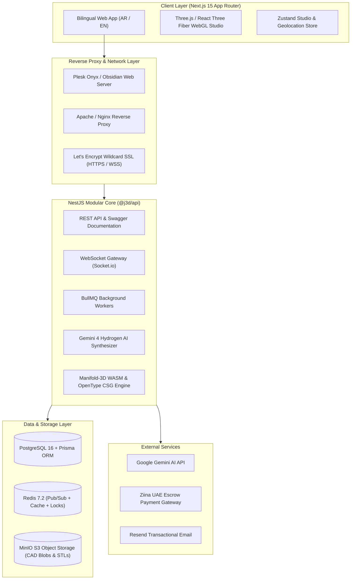

# 🏆 J3D Platform — On-Demand 3D Printing & Last-Mile Delivery Marketplace
> **United Arab Emirates (UAE) • Powered by Google Gemini 4 Hydrogen AI & Manifold-3D WASM**  
> *Production Domain: [https://j3d.msoms.ai](https://j3d.msoms.ai)*

[](https://j3d.msoms.ai)
[](https://nodejs.org/)
[](https://nextjs.org/)
[](https://nestjs.com/)
[](https://deepmind.google/technologies/gemini/)
[](https://github.com/elalish/manifold)
[](https://www.postgresql.org/)
[](https://redis.io/)
[](https://ziina.com/)

---

## 🌐 Language Navigation / تصفح اللغات
- [English Documentation](#-english-documentation)
  - [1. Executive Overview](#1-executive-overview)
  - [2. System Architecture](#2-system-architecture)
  - [3. Core Innovations & Modules](#3-core-innovations--modules)
  - [4. Monorepo Structure](#4-monorepo-structure)
  - [5. Local Development Quickstart](#5-local-development-quickstart)
  - [6. Production Deployment & Infrastructure](#6-production-deployment--infrastructure)
  - [7. CI/CD Automated Pipeline](#7-cicd-automated-pipeline)
  - [8. Verification & Playwright E2E Tests](#8-verification--playwright-e2e-tests)
- [التوثيق باللغة العربية (Arabic Documentation)](#-التوثيق-باللغة-العربية-arabic-documentation)
  - [١. نظرة عامة ورؤية المنصة](#١-نظرة-عامة-ورؤية-المنصة)
  - [٢. البنية المعمارية وتدفق البيانات](#٢-البنية-المعمارية-وتدفق-البيانات)
  - [٣. المحركات والابتكارات الجوهرية](#٣-المحركات-والابتكارات-الجوهرية)
  - [٤. دليل التشغيل والتطوير المحلي](#٤-دليل-التشغيل-والتطوير-المحلي)
  - [٥. النشر على خادم الإنتاج وسير العمل التلقائي CI/CD](#٥-النشر-على-خادم-الإنتاج-وسير-العمل-التلقائي-cicd)

---

# 🇬🇧 English Documentation

## 1. Executive Overview
**J3D** is an on-demand, hyper-local 3D printing and last-mile courier delivery marketplace engineered specifically for the UAE ecosystem. It bridges the gap between individual/corporate consumers seeking custom physical items and a distributed network of certified local 3D makers and couriers.

The platform eliminates standard CAD design friction by integrating **Google Gemini 4 Hydrogen** with the **Manifold-3D WebAssembly kernel**, enabling users to generate production-ready, 100% watertight parametric 3D models (such as customized recognition trophies, commemorative plaques, QR stands, and desk nameplates) directly in their browser within seconds.

Upon design finalization, orders undergo a **dual reverse-bidding auction**:
1. **Maker Radar:** Local makers within a calibrated Haversine radius bid based on equipment capabilities (FDM, SLA, SLS) and available material inventory (PLA Silk, PETG, ABS, Resin).
2. **Courier Dispatch:** Automated logistics dispatching matches certified couriers for same-day delivery with cryptographic **double-blind OTP verification** and **Ziina escrow financial protection**.

---

## 2. System Architecture



---

## 3. Core Innovations & Modules

### 3.1 AI 3D Plaque & Trophy Parametric Engine
- **Gemini 4 Hydrogen CSG Synthesis:** Transforms high-level user specifications into robust Constructive Solid Geometry (CSG) parameter trees.
- **Manifold-3D WASM Kernel:** Delivers sub-second boolean operations (Union, Difference, Intersection) guaranteed to produce 100% manifold, non-self-intersecting meshes ready for slicing.
- **Authentic Arabic & Latin Typography:**
  - Integrated vector outline extraction via `opentype.js` using high-fidelity typefaces (*Amiri Bold, Cairo, SF Arabic, Diwan Thuluth, Dubai*).
  - Handles Complex Right-to-Left (RTL) script reshaping using `arabic-persian-reshaper` and Bidirectional (BiDi) number reversal to ensure Gregorian dates (e.g. `2026`) and Latin characters project correctly without horizontal mirroring.
- **MakerWorld Aesthetic Architecture:**
  - Stepped base plinth with chamfered bevels for high-stability desk placement.
  - Recessed inscription bed with raised perimeter borders.
  - 3D top crest adornments (e.g., star emblems, graduation caps).
  - Dual-color Bambu Lab AMS 3MF multicolor slicing export compatibility.

### 3.2 Maker Radar & Geohash Auction
- **Dynamic Geospatial Discovery:** Employs Haversine distance computations and Geohashes to surface active 3D printing nodes in Abu Dhabi, Dubai, Sharjah, and across the Emirates.
- **Printer & Material Matching:** Filters makers by build volume (e.g., Bambu Lab X1C / P1S $256 \times 256 \times 256\text{ mm}$), nozzle resolution, and material stock (PLA Standard, Silk, PETG, ABS, Engineering Resins).
- **Automated Reverse Bidding:** Real-time push notifications broadcast print jobs to qualified makers; bids compete on price, turnaround hours, and historical quality ratings.

### 3.3 Courier Dispatch & Double-Blind OTP Verification
- **Tamper-Proof Custody Chain:**
  1. Maker prints and finishes the model, uploads physical QC photo, and requests courier pickup.
  2. Courier arrives; Maker verifies Courier identity via **Maker PIN**.
  3. Courier transports parcel with live GPS coordinates broadcasted to the customer dashboard.
  4. Delivery completion requires Customer to supply the **Delivery OTP (4-digit PIN)**, preventing false delivery claims.

### 3.4 Ziina UAE Financial Escrow
- Seamless dirham (AED) payment processing via Ziina.
- Customer funds are held in secure escrow upon order placement.
- Automated instant payout release to Maker and Courier upon cryptographic OTP delivery validation.

---

## 4. Monorepo Structure

```bash
J3D_Platform/
├── apps/
│   ├── api/                      # NestJS 11 Backend Application
│   │   ├── assets/fonts/         # Embedded TrueType Fonts (Amiri, Cairo, SF Arabic)
│   │   ├── prisma/               # Database Schema & Seed Migrations
│   │   └── src/
│   │       ├── modules/admin/    # Model Switcher & Admin Telemetry
│   │       ├── modules/auth/     # JWT Auth & Role-Based Access Control
│   │       ├── modules/orders/   # Order State Machine & Reverse Bidding
│   │       └── modules/studio/   # Manifold-3D WASM & Gemini AI CSG Builder
│   └── web/                      # Next.js 15 App Router Frontend
│       ├── messages/             # i18n Localization Dictionaries (ar.json, en.json)
│       ├── public/               # Static Web Assets
│       └── src/
│           ├── app/[locale]/     # Internationalized App Pages
│           │   ├── admin/        # Platform Operations & AI Model Catalog
│           │   ├── courier/      # Real-Time Delivery Dispatch Screen
│           │   ├── maker/        # Maker Radar & Job Auction Radar
│           │   └── orders/       # Order Lifecycle & Tracking
│           └── components/       # React Three Fiber 3D Canvas & UI Kit
├── infra/
│   └── docker/
│       ├── Dockerfile.api        # Multi-stage production build for NestJS
│       └── Dockerfile.web.prod   # Multi-stage production build for Next.js 15
├── packages/
│   └── shared-types/             # Unified TypeScript DTOs & Interfaces
├── .github/workflows/
│   └── deploy.yml                # Automated CI/CD GitHub Actions Workflow
├── docker-compose.yml            # Local development orchestration
├── docker-compose.prod.yml       # Production container topology
└── README.md                     # Bilingual Documentation
```

---

## 5. Local Development Quickstart

### Prerequisites
- **Node.js:** `v20.10.0` or higher
- **npm:** `v10.x` or higher
- **Docker & Docker Compose:** Docker Desktop or Docker Engine

### Step 1: Clone & Install Dependencies
```bash
git clone https://github.com/msoms-ai/j3d.git
cd j3d
npm install
```

### Step 2: Environment Configuration
Copy the template configuration file:
```bash
cp .env.example .env
```
Update critical keys in `.env`:
- `DEFAULT_GEMINI_API_KEY`: Your Google Gemini API Key.
- `JWT_ACCESS_SECRET` & `JWT_REFRESH_SECRET`: Secure 64-character hex strings.

### Step 3: Launch Local Backing Services
```bash
docker compose up -d postgres redis minio mailpit
```

### Step 4: Database Migrations & Seeding
```bash
npm run db:migrate
npm run db:seed
```

### Step 5: Launch Development Servers
Run all applications in parallel:
```bash
npm run dev
```
- **Web Client:** [http://localhost:3000](http://localhost:3000)
- **API Server & Swagger Docs:** [http://localhost:4000/docs](http://localhost:4000/docs)
- **MinIO Console:** [http://localhost:9001](http://localhost:9001) (`j3d_minio_user` / `j3d_minio_password`)
- **Mailpit Web UI:** [http://localhost:8025](http://localhost:8025)

---

## 6. Production Deployment & Infrastructure

The live production instance runs at **[https://j3d.msoms.ai](https://j3d.msoms.ai)** hosted on Ubuntu 20.04 LTS managed via Plesk Onyx/Obsidian with Docker Compose containerization.

### Production Port Allocations
| Service | Internal Container Port | Host Port Binding | Protocol | Description |
| :--- | :--- | :--- | :--- | :--- |
| **Next.js Web** | `3000` | `127.0.0.1:3070` | HTTP | Frontend SSR & Static Assets |
| **NestJS API** | `4000` | `127.0.0.1:8070` | HTTP / WS | REST Endpoints, WebSockets & Swagger |
| **MinIO S3** | `9000` | `127.0.0.1:9070` | HTTP | CAD & STL Object Storage |
| **MinIO Console** | `9001` | `127.0.0.1:9071` | HTTP | S3 Administration Dashboard |
| **PostgreSQL 16** | `5432` | Internal `j3d-net` | TCP | Relational Database |
| **Redis 7.2** | `6379` | Internal `j3d-net` | TCP | BullMQ Queue & Cache |

### Plesk Apache/Nginx Reverse Proxy Configuration
Configured in `/var/www/vhosts/system/j3d.msoms.ai/conf/vhost_ssl.conf`:
```apache
LimitRequestBody 0
ProxyPreserveHost On
RequestHeader set X-Forwarded-Proto "https"

# WebSocket proxy for real-time tracking
ProxyPass /api/v1/ws ws://127.0.0.1:8070/api/v1/ws
ProxyPassReverse /api/v1/ws ws://127.0.0.1:8070/api/v1/ws

# NestJS API & Swagger Docs
ProxyPass /api http://127.0.0.1:8070/api retry=0 timeout=600
ProxyPassReverse /api http://127.0.0.1:8070/api
ProxyPass /docs http://127.0.0.1:8070/docs retry=0 timeout=600
ProxyPassReverse /docs http://127.0.0.1:8070/docs

# MinIO S3 Object Storage
ProxyPass /storage/ http://127.0.0.1:9070/ retry=0 timeout=600
ProxyPassReverse /storage/ http://127.0.0.1:9070/

# Next.js Web Frontend
ProxyPass / http://127.0.0.1:3070/ retry=0 timeout=300
ProxyPassReverse / http://127.0.0.1:3070/
```

---

## 7. CI/CD Automated Pipeline

Automated continuous integration and deployment is managed via GitHub Actions in [`.github/workflows/deploy.yml`](.github/workflows/deploy.yml).

### Workflow Pipeline Stages
1. **Lint & Typecheck:** Validates clean compilation across `@j3d/shared-types`, `@j3d/api`, and `@j3d/web`.
2. **Automated Remote Deployment:** On merge to `main`, SSH connects to `135.181.209.123`:
   - Clones or fast-forwards `main`.
   - Executes `docker compose -f docker-compose.prod.yml up -d --build --remove-orphans`.
   - Runs database migrations via `npx prisma migrate deploy`.
   - Validates live HTTP response (`http_code: 200`) from backend health endpoints.

---

## 8. Verification & Playwright E2E Tests

The platform includes end-to-end automated browser suites verifying:
- **Typeform Parametric Plaque Generation:** Verified via [`preset-autofill-and-plaque-ai.spec.ts`](apps/web/e2e/preset-autofill-and-plaque-ai.spec.ts).
- **TrueType Arabic RTL & Number Formatting:** Verified across Amiri and SF Arabic fonts.
- **Maker Bidding & Courier Handshake:** Complete lifecycle verification from payment to OTP dispatch.

Run test suite locally:
```bash
npm run test:e2e
```

---

# 🇦🇪 التوثيق باللغة العربية (Arabic Documentation)

## ١. نظرة عامة ورؤية المنصة
**منصة J3D** هي أول منظومة إماراتية متكاملة للطباعة ثلاثية الأبعاد والتوصيل السريع فائق الدقة (On-Demand 3D Printing & Last-Mile Delivery). تهدف المنصة إلى ربط الأفراد والمؤسسات الراغبين في تصنيع منتجات ونماذج ملموسة بنخبة من صُنّاع الطباعة ثلاثية الأبعاد المرخصين ومناديب التوصيل المحليين عبر مختلف إمارات الدولة (أبوظبي، دبي، الشارقة، عجمان، أم القيوين، رأس الخيمة، الفجيرة).

تعتمد المنصة على دمج ثوري بين الذكاء الاصطناعي التوليدي **Google Gemini 4 Hydrogen** ومحرك الهندسة الصلبة الرياضي **Manifold-3D WebAssembly**، مما يتيح توليد نماذج هندسية حقيقية ثلاثية الأبعاد مصمتة وخالية تماماً من عيوب الأسطح (100% Watertight Manifold) في ثوانٍ معدودة مباشرة من المتصفح، مع دعم أصيل ودقيق للخطوط العربية والزخارف الإسلامية المتوافقة مع أحدث طابعات العالم متعددة الألوان (Bambu Lab AMS).

---

## ٢. البنية المعمارية وتدفق البيانات

تعمل المنصة بنظام المستودع البرمجي الموحد (Monorepo) وتضم:
1. **الواجهة الأمامية (apps/web):** مبنية بأحدث إصدارات **Next.js 15 (App Router)**، مع دعم فوري لتبديل اللغات (عربي / إنجليزي) وتوجيه الواجهات من اليمين إلى اليسار (RTL) واستوديو فحص ثلاثي الأبعاد تفاعلي بواسطة **Three.js** و **React Three Fiber**.
2. **الواجهة الخلفية (apps/api):** خادم مصغر فائق السرعة مبني بإطار عمل **NestJS 11**، يعتمد على بنية برمجية معيارية نظيفة، ويشمل قنوات الاتصال الحي **WebSockets** لنقل مسار المناديب ومزادات الصُنّاع لحظياً، وجدولة مهام **BullMQ** المعالجة في الخلفية.
3. **طبقة البيانات والتخزين:** قاعدة بيانات علائقية متقدمة **PostgreSQL 16** مع محرك استعلامات **Prisma ORM**، وخادم التخزين السحابي المحلي **MinIO S3** لتخزين ملفات الـ STL والـ 3MF، وذاكرة **Redis 7.2** للتحكم بالأقفال الموزعة والمزامنة اللحظية.

---

## ٣. المحركات والابتكارات الجوهرية

### ٣.١ استوديو الدروع التذكارية وتوليد الـ 3D بالذكاء الاصطناعي
- **محرك Gemini 4 Hydrogen:** يقوم بتحليل طلب العميل بدقة هندسية عالية وتوليد كود هندسي بارامتري ثلاثي الأبعاد (CSG).
- **التشكيل الهندسي المتين (Manifold-3D):** ينفذ عمليات الدمج والاقتطاع البولياني بدقة متناهية ويضمن سلامة المجسم للطباعة المباشرة دون الحاجة لإصلاح الشبكات (Mesh Repair).
- **محرفات الخط العربي الأصيل والأرقام المزدوجة (BiDi):**
  - معالجة تشابك الحروف العربية وتشكيلها الصحيح باستخدام `arabic-persian-reshaper`.
  - معالجة ذكية للأرقام والسنوات الميلادية (مثل `2026`) والحروف اللاتينية لمنع انعكاسها وضمان قراءتها بشكل مستقيم وطبيعي على واجهة الدرع.
- **تصميم فخم بمعايير MakerWorld العالمية:**
  - قاعدة صلبة مدرجة مع حواف مشطوفة لثبات مثالي على المكاتب.
  - تجويف داخلي للنصوص التذكارية محاط بإطار بارز أنيق.
  - تاج علوي رمزي (نجمة تميز، قبعة تخرج، أو شعار مخصص).
  - توافق كامل مع ملفات 3MF لتلوين الكتابة بلون والقاعدة بلون آخر.

### ٣.٢ رادار الصنّاع ومزاد العطاءات العكسي (Maker Radar)
- مسح جغرافي فوري لمواقع الصنّاع في دولة الإمارات وحساب المسافات الجغرافية الدقيقة.
- مطابقة مواصفات الطابعات (FDM, SLA, SLS) وأبعاد منصة الطباعة مع حجم المجسم المطلوب.
- فحص توفر المواد المطلوبة (PLA حريري، PETG مقاوم للحرارة، ABS، راتنجات هندسية).
- نظام مناقصات عكسي يتيح للصناع تقديم عروضهم فورياً وتنافسياً لتقديم أفضل سعر وأسرع وقت تنفيذ للعميل.

### ٣.٣ توجيه المناديب والتسليم الآمن برمز التحقق السري (OTP)
- سلسلة تسليم محكمة غير قابلة للتلاعب:
  1. يقوم الصانع بإنهاء الطباعة ورفع صورة التحقق من الجودة وطلب مندوب الاستلام.
  2. يتحقق الصانع من هوية المندوب عبر **رمز الصانع السري**.
  3. ينطلق المندوب نحو العميل مع بث مباشر لموقعه الجغرافي على خريطة التتبع التفاعلية.
  4. لا يتم تسليم الطلب وإغلاقه إلا بعد إدخال **رمز الاستلام السري المكون من 4 أرقام** الموجود لدى العميل فقط، مما يمنع النزاعات وادعاءات التسليم الخاطئ.

### ٣.٤ الضمان المالي وبوابة الدفع Ziina
- حجز قيمة الطلب مسبقاً في حساب الضمان (Escrow) عند الدفع عبر بوابة **Ziina** الإماراتية المعتمدة.
- تحرير فوري وتلقائي للأموال لحسابات الصانع والمندوب بمجرد تأكيد التسليم الناجح عبر رمز الـ OTP.

---

## ٤. دليل التشغيل والتطوير المحلي

### المتطلبات الأساسية
- بيئة تشغيل **Node.js 20+**
- حزمة **npm 10+**
- نظام **Docker** و **Docker Compose**

### خطوات التثبيت والتشغيل
```bash
# 1. استنساخ المستودع البرمجي
git clone https://github.com/msoms-ai/j3d.git
cd j3d

# 2. تثبيت الحزم والمكتبات المشتركة
npm install

# 3. إعداد متغيرات البيئة
cp .env.example .env

# 4. تشغيل قواعد البيانات والخدمات السحابية
docker compose up -d postgres redis minio mailpit

# 5. تطبيق ترحيل الجداول وملء البيانات الاختبارية
npm run db:migrate
npm run db:seed

# 6. تشغيل واجهة المستخدم والخادم في وضع التطوير
npm run dev
```

- واجهة المستخدم التفاعلية: `http://localhost:3000`
- وثائق الـ API التفاعلية (Swagger): `http://localhost:4000/docs`
- لوحة إدارة التخزين السحابي MinIO: `http://localhost:9001`

---

## ٥. النشر على خادم الإنتاج وسير العمل التلقائي (CI/CD)

يعمل النظام في بيئة الإنتاج الحية على النطاق الرسمي:
🔗 **[https://j3d.msoms.ai](https://j3d.msoms.ai)**

- يتم النشر المؤتمت بالكامل عبر **GitHub Actions** عند كل عملية دمج أو دفع إلى فرع `main`.
- يتم تجميع حاويات Docker المعيارية في الخادم وتحديث قواعد البيانات دون انقطاع في الخدمة.
- شهادة الأمان المشفرة: **Let's Encrypt SSL/TLS** مفعلة تلقائياً مع توجيه آمن من HTTP إلى HTTPS.

---

## 📄 License & Attribution
Developed and maintained under the **msoms.ai** 2026 Technology Initiative. All rights reserved.
